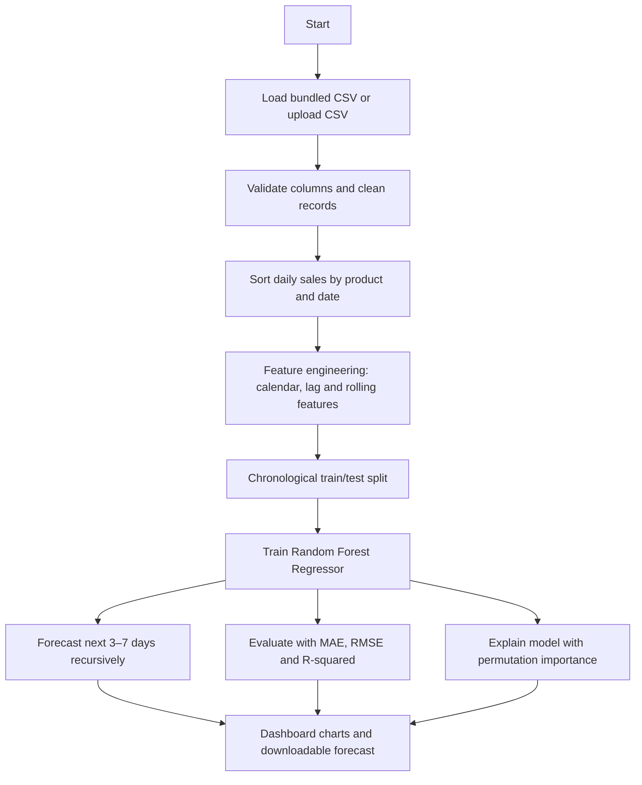

# Sales Prediction Using Machine Learning

A small, database-free Streamlit application that analyses historical daily sales and forecasts the next 3–7 days. It includes a Random Forest regression model, time-based evaluation, global permutation feature importance, and a local sensitivity explanation.

## Project scope
- Input: CSV (`date`, `product_id`, `sales`)
- Bundled sample: exactly 17,000 synthetic daily product records
- Forecast horizon: selectable 3–7 days
- Model: RandomForestRegressor with calendar, lag, and rolling-average features
- Evaluation: chronological 7-day holdout; MAE, RMSE, R², actual-vs-predicted, residual histogram
- XAI: permutation importance (global) and local feature sensitivity (individual forecast)
- No database, Flask, login, inventory, billing, or cloud credentials required

## Flow chart


## Folder structure
```text
sales_prediction_using_ML/
├── app.py
├── requirements.txt
├── runtime.txt
├── README.md
├── data/
│   └── sample_sales_17000.csv
├── src/
│   ├── __init__.py
│   ├── forecasting.py
│   └── prepare_kaggle_subset.py
└── docs/
    ├── DATASET_GUIDE.md
    ├── RESEARCH_PAPERS.md
    └── RUN_GUIDE.md
```

## Quick start (Windows)
1. Install Python 3.10 or 3.11 from https://www.python.org/downloads/ . During setup, tick **Add Python to PATH**.
2. Extract this ZIP. Open the `sales_prediction_using_ML` folder in VS Code or PyCharm.
3. In the project folder, open Terminal.
4. Create a virtual environment: `py -3.11 -m venv .venv`
5. Activate it: `.venv\Scripts\activate`
6. Upgrade pip: `python -m pip install --upgrade pip`
7. Install dependencies: `pip install -r requirements.txt`
8. Run: `streamlit run app.py`
9. A browser tab opens. If not, visit http://localhost:8501 .
10. The bundled 17,000-row sample loads automatically. Set forecast horizon to 3–7 days and select a product.

Detailed steps, troubleshooting and deployment are in `docs/RUN_GUIDE.md`.

## Use your own data
Your CSV must have these exact columns:
```csv
date,product_id,sales
2024-01-01,PRODUCT_A,12
2024-01-02,PRODUCT_A,15
```
Use the sidebar uploader. Data is processed in app memory for that session; this application does not save uploaded files to a database. For forecasting, each product needs at least 15 chronological daily observations.

## Dataset note
`data/sample_sales_17000.csv` is synthetic demonstration data generated for this project. It is exactly 17,000 rows (17 product IDs × 1,000 days). It is useful for running and demonstrating the dashboard, but it must not be described as real customer or retail data. See `docs/DATASET_GUIDE.md` for a public real-data source and a reproducible way to create a <=17,000-row subset.

## Methodological notes
- The latest seven calendar days are held out for evaluation; the split is chronological to reduce time leakage.
- Future values are forecast recursively: each prediction becomes a lag input for the next day. Errors can accumulate over a multi-day horizon.
- Permutation importance is global and measures predictive reliance, not causality.
- Local sensitivity changes one lag/rolling input by 10% at a time; it is an approximate explanation, not SHAP and not a causal statement.
- Compare against a naive baseline (e.g., previous-week same-day sales) before claiming the ML model is better. This compact teaching app is a starting point for MCA work, not a production forecasting service.

## Free deployment
Deploy on Streamlit Community Cloud: push this folder to a GitHub repository; visit https://share.streamlit.io/ ; sign in with GitHub; choose the repository, branch and `app.py`; deploy. The app includes its 17k sample CSV, so no database or external storage is required. Free-tier availability, resource limits and sleep behavior may change; check the official docs before deployment.
